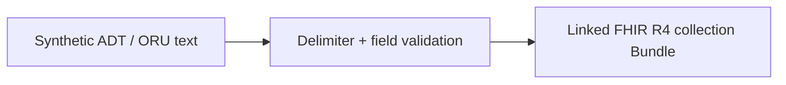

# hl7v2-to-fhir

Convert a documented HL7 v2.5.1 ADT/ORU subset into linked FHIR R4 resources.

[](https://github.com/code-rowthtech/hl7v2-to-fhir/actions/workflows/ci.yml)

Educational sample using synthetic data. The badge above reports the actual GitHub Actions status; passing local tests does not imply exchange acceptance or production readiness.

## The problem it solves

Legacy registration and lab-result messages need an explicit, testable mapping into patient, encounter and observation resources.

All bundled sample data is invented and synthetic. No real people, production exports, client code or credentials are included. This is a working scoped sample, not a production implementation.

## How it works



The output above abbreviates entries to resource-type names; actual output contains full resources and resolvable `urn:uuid` references. Resource IDs are deterministic and scoped by sending application/facility, the first patient identifier and its assigning authority/type, plus message and result identity where applicable. Missing sender fields or message control IDs are rejected. Supported events: ADT A01/A04 and ORU R01, with standard delimiters, one patient and one OBR order. ADT requires a visit ID in PV1-19. ORU supports numeric (NM) and text (ST) observations and F/P/C statuses. Other events, multiple orders and unsupported value types fail explicitly.

```bash
python3 -m src.cli sample-data/registration.hl7
```

This is a scoped educational mapper, not a general-purpose HL7 parser or a complete clinical mapping implementation. No EHR endpoint or credentials are required.

## Run it in 3 commands

Python 3.11+; no third-party dependencies. Use Python 3.12 to match CI. Run these from this repository's directory after cloning/extracting it:

```bash
python3 --version
python3 -m unittest discover -s tests -v
python3 -m src.cli
```

Dependencies may need an initial internet download. Default examples use only bundled synthetic data and local processing. Nothing is sent to a healthcare exchange. Environment templates list names only and contain no values; offline samples need no environment variables.

## Sample input and output

`sample-data/registration.hl7` is ADT A04; `sample-data/result.hl7` is ORU R01.

Expected summary (or abbreviated structured output):

```text
{"resourceType":"Bundle","type":"collection","entry":["Patient", "Observation", "DiagnosticReport"]}
```

Full output examples are under `sample-data/expected-output.json` when applicable. Generated artifacts go to ignored `output/`. Tests cover valid data and meaningful negative cases; the CI workflow runs tests, the demo command, TypeScript checks where relevant, and Gitleaks.

## What we would add in production

Use a maintained HL7 parser and the full HL7 v2-to-FHIR IG, validate FHIR profiles, preserve assigning authorities, time zones, repeats and escapes, add ACK/NACK handling, terminology mapping and multi-order support.

## Built by RowthTech

Healthcare software engineering samples, independently written for this portfolio. MIT licensed. Priority: P0; market: US.

Primary references consulted on 13 November 2026:

- [https://www.hl7.org/fhir/uv/v2mappings/message_maps.html](https://www.hl7.org/fhir/uv/v2mappings/message_maps.html)
- [https://hl7.org/fhir/R4/observation.html](https://hl7.org/fhir/R4/observation.html)
- [https://hl7.org/fhir/R4/diagnosticreport.html](https://hl7.org/fhir/R4/diagnosticreport.html)

Before public release: clean-clone run, clean Gitleaks scan, second-engineer review, and approval from Mukesh or Raavish. For GCC samples, current exchange implementation-guide/profile review is an additional publication gate. No approvals or exchange acceptance are implied by local tests.
